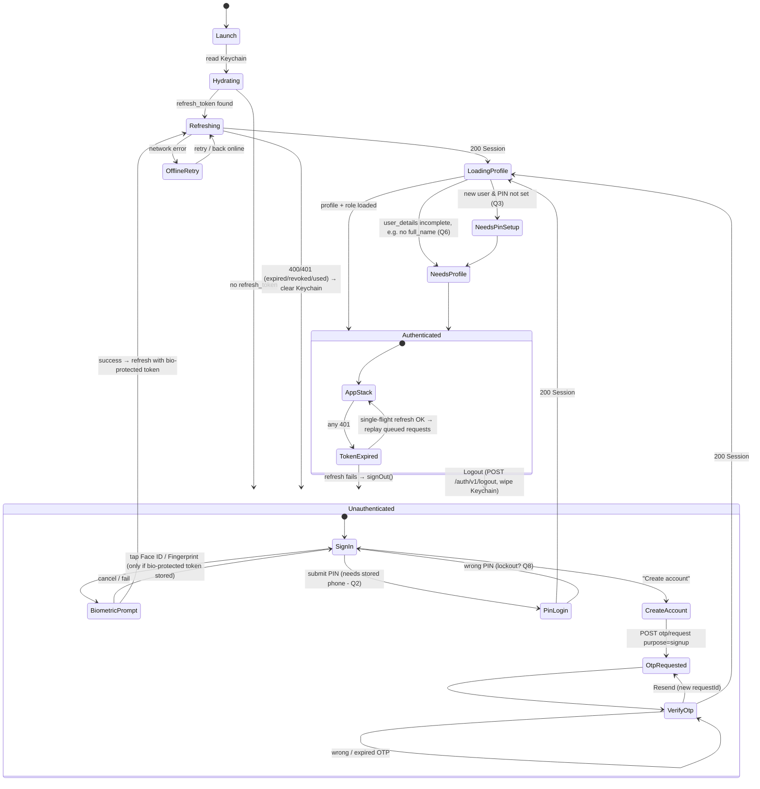

# STEROW mobile — API integration plan (Phase B)

> Status: **Phase 1 onboarding API** (branch `feat/phase1-onboarding-api`), see §9. Auth phase B done. §6 holds facts confirmed live on 2026-11-19 and supersedes earlier guesses in §1–§2.
> Date: 2026-11-18 · Inputs: `docs/api/openapi.json`, `docs/api/ENDPOINTS.md`, current `src/` (Sign In / Create Account / Verify OTP).

---

## 0. Where the spec came from (read this first)

- `https://demo.sterow.in/swagger` is **not** a stock Swagger UI. It's a TanStack Start (Lovable) route. The route chunk `/assets/swagger-ZwAsLlDm.js` builds the OpenAPI object **in JavaScript** (`m(supabaseUrl, publishableKey, origin)`) and passes it to `SwaggerUIBundle({ spec })`. **There is no spec URL.** `/swagger.json`, `/swagger/v1/swagger.json`, `/openapi.json` and `/api-docs` all return the SPA HTML (HTTP 200, `text/html`).
- I did **not execute** the downloaded bundle. `docs/api/openapi.json` is a hand transcription of that builder, rendered with the same inputs Swagger UI uses. Cross-check: 109 paths and 243 operations; the path names diff 1:1 against the bundle.
- **Recommended:** ask the backend dev to commit or publish the spec (Q17). The page has no export link under the title because the spec is inline, and the Swagger UI instance isn't exposed on `window`, so a DevTools export isn't straightforward either.
- Spec: **STEROW API v1**, OpenAPI 3.0.3.
- **The spec is thin.** It names only one schema (`Session`). Every table and RPC response is an untyped `object`/`array<object>`, and there are no examples. Most typing will have to come from Supabase DB types (see Q14).

### What the backend actually is
| Layer | Base URL | Notes |
|---|---|---|
| Supabase GoTrue (auth) | `https://pasyjiqmhpdoenozscwt.supabase.co/auth/v1` | email/password, refresh, logout, current user |
| Supabase PostgREST (data) | `…supabase.co/rest/v1` | tables + `rpc/*` functions, protected by RLS |
| Supabase Storage | `…supabase.co/storage/v1` | private buckets, signed URLs |
| STEROW app server ("Mobile Actions") | `https://demo.sterow.in/api/public/v1` | **mobile OTP**, mobile+password sign-in, OCR, payments (Cashfree), maps, invites |

Verified live with harmless probes (no SMS sent):
- `POST APP/auth/otp/request {}` → `400 {"error":{"code":"bad_request","message":"Required; Required"}}`
- `POST APP/auth/otp/request {"phone":"123","purpose":"signin"}` → `400 {"error":{"code":"bad_request","message":"Enter a valid India or UAE mobile number"}}`
- `POST APP/auth/otp/verify` with a dummy requestId → `400 {"error":{"code":"bad_request","message":"This OTP request is no longer valid. Request a new one."}}`
- `POST APP/settings/app {}` → `200 {"data":{brand_name, logoUrl, …}}`

Takeaways: the APP envelope is confirmed. **Every error code is the same `bad_request`**, so only the free-text message tells cases apart. The backend also accepts **UAE** numbers.

---

## 1. Auth flow mapping

### 1.1 Screen → endpoint table

| Screen / action | Endpoint | Request | Response | Confidence |
|---|---|---|---|---|
| **Create Account → Continue** (send OTP) | `POST APP/auth/otp/request` (no auth) | `{ phone: "+91XXXXXXXXXX", purpose: "signup", fullName?, referralCode?, referralToken?, inviteToken? }` | `{ data: … }`, which **presumably** includes `requestId` (verify requires it). Exact shape is undocumented. | Medium |
| **Verify OTP → Confirm** | `POST APP/auth/otp/verify` (no auth) | `{ requestId, otp, purpose: "signup" }` | "returns a full session": `Session { access_token, refresh_token, expires_in, token_type, user }`, probably wrapped in `{ data }` | Medium |
| **Verify OTP → Resend code** | *No resend endpoint.* Call `POST APP/auth/otp/request` again → **new `requestId`**. | same as send | same | Medium (cooldown/limits unknown) |
| **Sign In → PIN** | ❌ **No PIN endpoint exists.** Closest match: `POST APP/auth/signin-mobile { phone, password }`. The Sign In screen has **no phone field**, and the backend password is `minLength: 8` (reset/change), while the UI PIN is 4–6 digits. | — | presumably `Session` | **Blocked: Q1–Q3** |
| **Sign In → Face ID / Fingerprint** | ❌ **No biometric/device-token endpoint.** Proposal: after any successful login, store `refresh_token` in Keychain/Keystore behind biometric access control. Biometric success → read the token → `POST SB/auth/v1/token?grant_type=refresh_token` → new session. | `{ refresh_token }` + `apikey` | `Session` | High (standard pattern), needs your OK (Q4) |
| Refresh token | `POST SB/auth/v1/token?grant_type=refresh_token` | header `apikey`; `{ refresh_token }` | `Session` | High |
| Logout | `POST SB/auth/v1/logout` | `apikey` + Bearer | `204` | High |
| Current user (auth) | `GET SB/auth/v1/user` | `apikey` + Bearer | GoTrue user (`id`, `phone`, `user_metadata`, …) | High |
| Profile | `GET SB/rest/v1/user_details?user_id=eq.<uid>&select=*` | `apikey` + Bearer | `[ { full_name, phone, photo, department, designation, referral_code, … } ]` | Medium (columns not typed) |
| Role (routes customer vs vendor vs technician/driver) | `GET SB/rest/v1/user_roles?user_id=eq.<uid>&select=roles(name)` and/or `POST SB/rest/v1/rpc/my_permissions` | | | Medium (Q11) |
| Forgot PIN (future) | `APP/auth/otp/request {purpose:"recovery"}` → `APP/auth/reset-password { requestId, otp, password(min 8) }` | | | Depends on Q1 |
| OTP sign-in for existing users (not in UI) | `APP/auth/otp/request {purpose:"signin"}` → `APP/auth/otp/verify {purpose:"signin"}` | | `Session` | Medium (Q5) |

### 1.2 Phone format
- The UI holds 10 digits (`/^[6-9]\d{9}$/`) and shows a static `+91` prefix.
- The API example is E.164 `+919876543210`, and live validation says "India or UAE".
- **Plan:** a single `toE164('+91', digits)` util at the service boundary. Screens keep 10 digits.

### 1.3 Auth state machine



---

## 2. Gaps & mismatches

| # | UI / app needs | API provides | Impact |
|---|---|---|---|
| G1 | PIN login (4–6 digits, PIN field only) | No PIN concept. Mobile+**password** (min 8 on reset/change) or email+password. | **Blocker** for Sign In |
| G2 | Sign In has no phone field | `signin-mobile` needs `phone` | Must store the last phone locally, or change the UI |
| G3 | Biometric login | No endpoint | Client-side pattern (refresh token behind biometrics) |
| G4 | OTP length **4** (`OTP_LENGTH = 4`, stub accepts `1234`) | Example `otp: "123456"` → likely **6** | UI constant + OtpInput box count |
| G5 | Resend button, 30s timer | No resend endpoint; re-request gives a new `requestId`. Cooldown and max attempts undocumented. | Timer may disagree with the server's rate limit |
| G6 | "Set PIN" after signup? | No such step in the API | Unknown whether a screen is missing |
| G7 | Create Account asks only for the mobile number | `otp/request` accepts `fullName` (optional per spec) | Where does the name get collected? |
| G8 | Distinct errors: wrong OTP vs expired OTP vs too many attempts | All errors `code: "bad_request"` + free text | Brittle message matching unless the backend adds codes |
| G9 | Typed responses | Only `Session` is typed; no examples | Need DB types or sample responses |
| G10 | ~~+91 only~~ → India + UAE picker (2026-11-19, §8) | Backend also accepts UAE | Done |
| G11 | Single base URL (`API_BASE_URL`) | Two servers (Supabase + app server) + mandatory `apikey` header | Architecture change (§4) |
| G12 | Staging/production | Only `demo.sterow.in` + one Supabase project known | Env files can't be filled in yet |
| G13 | Existing number tapping "Create Account" | `purpose=signup` behaviour for existing users undocumented | Need to know the error/redirect |

### Open questions for Sumanth
1. **PIN:** is the app PIN the same thing as the account *password* used by `POST /api/public/v1/auth/signin-mobile`? If yes, how does that square with `minLength: 8` on `reset-password`/`PUT /auth/v1/user` while the UI allows 4–6 digits? If not, is a PIN endpoint (set / verify / reset) coming?
2. **Sign In identity:** the Sign In screen has only a PIN field. Should the app remember the last verified phone on the device, and is a "not you? / switch number" link needed? Or should the UI gain a phone field?
3. **PIN setup:** after a signup OTP verify, must the user set a PIN? Which endpoint? Is there a screen in Figma we don't have yet?
4. **Biometrics:** OK to implement Face ID / Fingerprint as "refresh token stored behind device biometrics", enabled only after one successful PIN/OTP login? Or does the backend plan a device-key endpoint?
5. **Existing users:** should an existing user ever use OTP sign-in (`purpose: "signin"`)? What does `purpose: "signup"` return for an already-registered number?
6. **Full name / referral:** where is `fullName` collected (it's optional in `otp/request`)? Do we need `referralCode` / deep-link `referralToken` on Create Account?
7. **OTP details:** is the OTP **6 digits**? What are its expiry, resend cooldown, max resends and max wrong attempts? Is a second `otp/request` the official "resend"? Does it invalidate the previous `requestId`?
8. **Lockout:** is there a lockout after N wrong PIN/password attempts, and what does the response look like?
9. **Exact response shapes** for `otp/request` (is it `{ data: { requestId } }`?), `otp/verify` and `signin-mobile` (is it `{ data: Session }` or a bare Session? What's inside `user`?).
10. **Error codes:** can the app server return distinct `error.code`s (e.g. `otp_invalid`, `otp_expired`, `otp_rate_limited`, `user_exists`, `invalid_credentials`) instead of `bad_request` for everything?
11. **Roles:** after login, how does the app decide customer vs vendor vs technician vs driver? `user_roles → roles(name)`, `my_permissions`, or something else? Can one user hold several roles?
12. **Token lifetimes:** access token ~1h per the docs. What are the refresh-token lifetime and rotation settings (Supabase rotation + reuse interval)? Should a session survive indefinitely while the app is used?
13. **Environments:** what are the staging and production URLs (app server + Supabase project)? Is `demo.sterow.in` the staging environment?
14. **Types:** can we get `supabase gen types typescript` output (or read access to run it), or at least sample JSON for `user_details`, `user_roles`, `service_bookings`, `booking_invoices_payments`? The spec has no column schemas.
15. **Test number:** for the live smoke test, which test number should I use? Does the demo backend have a fixed test OTP for it, or will someone read the SMS?
16. ~~**Country:** stay +91-only in the app for now, even though the backend accepts UAE?~~ → Answered: India + UAE (§8).
17. **Spec source:** can the backend publish the spec at a stable URL (e.g. `/api/public/v1/openapi.json`) so we can regenerate types in CI?

---

## 3. Future features — endpoint groups

| App feature (Figma) | Endpoints |
|---|---|
| **Onboarding / profile** | `GET/PATCH rest/v1/user_details`, `user_driving_licenses`, `PUT auth/v1/user` (password), `storage avatars`, `APP /ocr/driving-license`, `APP /settings/app`, `rpc/generate_my_reminders` |
| **Vendor onboarding** | `APP /auth/otp/request` with `vendorSignup{…}`, `APP /vendor/register`, `rpc/vendor_signup_brands`, `APP /technician/onboard/start` + `/verify`, `APP /invites/staff` |
| **Vendor management** | `vendor_details`, `vendor_branches`, `vendor_technicians`, `vendor_drivers`, `vendor_platform_fees`, `vendor_spare_part_prices`, `rpc/vendor_lookup_details`, `rpc/vendor_lookup_branches`, `rpc/booking_staff` |
| **Slots management** | `vendor_weekly_hours`, `vendor_holidays` (CRUD), `rpc/booking_branch_schedule {_branch}`, `booking_controls` (read) |
| **Lead details** | `rpc/my_booking_roles`, `service_bookings` (+ `?status=eq.requested`), `rpc/technician_respond`, `rpc/set_booking_technicians`, `booking_technicians`, `booking_status_history`, `booking_logistics`, `booking_inspections` + storage `booking-files` |
| **Estimates** | `booking_estimations`, `rpc/respond_estimate`, `rpc/request_estimate_changes`, `rpc/set_estimate_item_status`, `APP /ocr/estimate` |
| **Invoice details & payments** | `booking_invoices_payments`, `rpc/booking_platform_fee`, `APP /payments/order` (Cashfree, `returnUrl: sterow://payment-result`), `APP /payments/verify`, `booking_cash_collections`, `rpc/record_cash_collection`, `rpc/review_cash_collection`, `work_dues` |
| **Booking (customer)** | `rpc/my_bookable_vehicles`, `rpc/booking_centers`, `rpc/public_service_centers`, `rpc/booking_service_catalog`, `rpc/booking_package_catalog`, `service_bookings` POST, `booking_packages` |
| **Vehicles & documents** | `user_vehicles`, `rpc/my_vehicle_access`, `rpc/can_manage_vehicle`, `rpc/vehicle_latest_odometer`, `APP /vehicles/lookup`, `vdocs_*` (4), `APP /ocr/rc`, `APP /ocr/document`, storage `vehicle-docs`/`vehicle-rc`, vehicle masters (9 tables) |
| **Sharing** | `vehicle_shares`, `APP /shares/otp/send`, `/shares/otp/verify`, `APP /invites/vehicle` |
| **Addresses / pickup-drop** | `user_addresses`, `APP /places/suggest|details|reverse`, `booking_logistics`, `rpc/customer_update_drop` |
| **Rewards & notifications** | `referrals`, `notifications` (PATCH `read_at`), `APP /invites/referral` |
| **Permissions / menus** | `rpc/my_permissions`, `rpc/has_permission`, `menus`, `user_roles`, `roles`, `user_role_permissions`, `role_dashboards` |
| **Files** | `POST/DELETE storage/v1/object/{bucket}/{path}`, `POST storage/v1/object/sign/{bucket}/{path}` |

Each future module follows the same pattern: `ENDPOINTS.<MODULE>` → `<module>.service.ts` → zod schema → `use<Module>Queries/Mutations` → screen.

---

## 4. Proposed architecture (for approval)

Your structure, with **four changes** driven by the spec. Each change is explained below.

```
src/
  config/env.ts            SUPABASE_URL, SUPABASE_PUBLISHABLE_KEY, APP_API_BASE_URL, ENV_NAME
                           via react-native-config (.env.development/.staging/.production); validated with zod at startup
  api/
    endpoints.ts           single registry; every entry carries its server:
                             AUTH: {
                               SEND_OTP:   { server: 'app', path: '/auth/otp/request' },
                               VERIFY_OTP: { server: 'app', path: '/auth/otp/verify' },
                               LOGIN_PIN:  { server: 'app', path: '/auth/signin-mobile' },   // pending Q1
                               REFRESH:    { server: 'sb',  path: '/auth/v1/token?grant_type=refresh_token' },
                               LOGOUT:     { server: 'sb',  path: '/auth/v1/logout' },
                               ME:         { server: 'sb',  path: '/auth/v1/user' },
                             },
                             USER: { DETAILS: { server: 'sb', path: '/rest/v1/user_details' } },
                             VENDOR: { BY_ID: (id: string) => ({ server: 'sb', path: `/rest/v1/vendor_details?id=eq.${id}` }) },
    client.ts              two axios instances sharing interceptors:
                             sbClient  – baseURL SUPABASE_URL, always sends `apikey`, Bearer when signed in
                             appClient – baseURL APP_API_BASE_URL, Bearer when signed in, unwraps { data }
                           timeout 15s; 401 → single-flight refresh (queue) → replay once; refresh failure → authStore.signOut()
                           request(endpoint, config) picks the instance from endpoint.server
    postgrest.ts           tiny typed query builder: eq/in/ilike/order/limit/offset/select → params (no string URLs in services)
    errors.ts              ApiError + normalizeError() over 4 shapes: network/timeout, APP {error:{code,message}},
                           PostgREST {code,message,details,hint}, GoTrue {error_code,msg}|{error,error_description}
                           + mapping of known APP messages → stable codes (until Q10 lands)
    types/                 generated.ts (openapi-typescript, for paths/bodies) + database.ts (supabase gen types, Q14)
                           → friendly re-exports per module
    schemas/               zod: Session, OtpRequestResponse, GoTrueUser, UserDetails, ApiErrorEnvelopes
    services/auth.service.ts  sendOtp, resendOtp, verifyOtp, loginWithPin, refreshSession, logout, getMe, getProfile
  hooks/api/               useAuthMutations.ts, useProfileQuery.ts, queryKeys.ts (TanStack Query)
  store/auth.store.ts      zustand: status 'idle'|'hydrating'|'authenticated'|'unauthenticated', session meta, user, role,
                           lastPhone; hydrate(), signIn(session), signOut(), setTokens()
  storage/secureStorage.ts react-native-keychain: session (access+refresh) and a separate biometric-protected
                           refresh-token entry (accessControl BIOMETRY_ANY_OR_DEVICE_PASSCODE)
  storage/storage.ts       react-native-mmkv: lastPhone (masked display), biometricsEnabled, onboarding flags
  navigation/              RootNavigator switches Auth / Onboarding / App stacks by store status (removes resetToHome)
  utils/logger.ts          __DEV__ only; redacts Authorization, apikey, access_token, refresh_token, password, otp, pin, phone
  utils/phone.ts           toE164 / fromE164
```

**Changes vs your proposal, and why:**
1. **Two servers, not one `API_BASE_URL`.** The backend is Supabase plus a separate app server, with different auth headers and envelopes. Each registry entry carries `server`, so the "no URL strings elsewhere" rule still holds.
2. **`apikey` header + publishable key in env.** Supabase rejects requests without it. The key is client-safe, but it still lives in `.env.*`, not in source.
3. **`postgrest.ts` query builder + Supabase DB types.** openapi-typescript alone yields almost nothing (one schema), so per-table types need `supabase gen types` (Q14). Until then, zod schemas are the source of truth for the few responses we consume.
4. **A single-flight refresh is mandatory, not just nice-to-have.** Supabase refresh tokens are rotating and single-use, so two concurrent refreshes would log the user out.

Considered and **not** recommended: `@supabase/supabase-js`. It handles refresh, storage and PostgREST natively. But it would bypass the endpoint registry, the axios interceptors and msw-friendly testing, and it doesn't cover the app server. Worth revisiting if the PostgREST surface grows large.

New dependencies (pending approval): `axios`, `@tanstack/react-query`, `zustand`, `zod`, `react-native-keychain`, `react-native-mmkv`, `react-native-config`. Dev: `openapi-typescript`, `msw`, `@testing-library/react-native`, `tsx` (for the smoke script). Existing `react-native-biometrics` would be replaced by keychain access control for the token-unlock flow, or kept just for `isSensorAvailable`.

Rules (unchanged): screens → hooks only; no `any`; every service function unit-tested; the existing `src/services/auth.ts` stub is deleted once the hooks land.

---

## 5. Testing & quality plan

**Unit (jest)**
- `auth.service`: correct endpoint + body (E.164 phone, purpose), `{data}` unwrap, zod failure → `ApiError('SCHEMA_MISMATCH')`.
- `normalizeError`: one table-driven test per shape (network, timeout `ECONNABORTED`, APP 400, PostgREST 401/403, GoTrue 400, 500, non-JSON body) plus friendly message mapping.
- `client` refresh queue: 3 concurrent 401s → exactly **one** refresh call → all 3 replayed; refresh 400 → `signOut` once, every queued request rejected; a replayed request returning 401 again doesn't loop.
- `auth.store`: hydrate with/without/expired tokens, signIn persists to Keychain, signOut wipes Keychain + query cache.
- `validation`/`phone` utils, `postgrest` builder, logger redaction.

**Integration (msw/node + @testing-library/react-native)**
- The spec has no examples, so handlers come from **recorded fixtures**: the live envelopes captured in §0, plus real success payloads captured once by the smoke test. They live in `__fixtures__/` and are validated against the zod schemas.
- Flows: Create Account → Verify → Authenticated; wrong OTP; expired OTP (`"no longer valid"`); resend issues a new requestId; offline; timeout; 500; 401 → refresh → retry; refresh failure → back on SignIn; PIN success/wrong; biometric success/cancel/unavailable.

**Live smoke test** `scripts/smoke-auth.ts` (run with `npx tsx`, reads `.env.staging` + `SMOKE_PHONE`, refuses to run without it)
- `settings/app` → `otp/request (signin)` → prompts for the OTP on stdin (or a fixed test OTP, Q15) → `otp/verify` → `auth/v1/user` → `user_details` → `refresh` → `logout`. Prints PASS/FAIL + status + latency per step, redacted. Never part of CI.

**Gates:** `npm run typecheck`, `npm run lint`, `npm run check:colors`, `jest --coverage` with thresholds of **≥ 80%** lines/branches on `src/api/**`, `src/store/**`, `src/hooks/api/**` (enforced in `jest.config.js` `coverageThreshold`).

**Edge cases explicitly covered**
- Double-tap submit: the mutation's `isPending` disables the button, and the service dedupes in-flight `sendOtp`.
- Leaving a screen mid-request: `AbortController` signal from the hook; no state update after unmount; aborts aren't surfaced as errors.
- App backgrounded during the countdown: timer based on a stored `expiresAt` timestamp, not on ticks, so it survives background/foreground (current `useCountdown` ticks; it'll be adapted).
- Slow network: spinner after 300 ms, 15 s timeout → friendly retry message.
- Keyboard + loading: inputs disabled while pending, keyboard dismissed on submit, errors announced for accessibility.
- Expired token at launch: hydrate → refresh before showing the App stack; offline at launch → cached session with a retry banner, never a silent logout.
- Server rotates the refresh token while the app is killed mid-refresh: new tokens are persisted before the request resolves.

---

## 6. Live-confirmed facts (2026-11-19, `scripts/smoke-auth.ts`, test login 9999999999)

| Topic | Confirmed | Notes |
|---|---|---|
| Phone format (India) | **10 digits, no `+91`** (`"9876543210"`) | Same as the web. `utils/phone.ts#formatForApi` is the single place. |
| Phone format (UAE) | **`"971"` + 9 digits, no `+`, trunk `0` stripped** (`"971501234567"`); **no country field** | See §8. Confirmed from the web bundles only; no UAE OTP was sent. |
| `otp/request` response | `{ data: { requestId: uuid, isNewUser: boolean } }` | **No success message in the body**; toasts use app copy. "OTP request ready" is also treated as success if a message ever appears. |
| `otp/verify` response | `{ data: { access_token, refresh_token, expires_in: 3600, token_type, user } }` | **Session variant, not tokenHash.** The app still accepts `{tokenHash}` (→ `verifyOtp({token_hash, type:'magiclink'})`) in case the public API changes to mirror the web. |
| Cooldown | 30 s per number, **also for the test number**; a rejected request does not reset it | `"Please wait 30 seconds before requesting another OTP."` |
| OTP expiry | Exists: `"OTP expired. Request a new one."` | **Expiry window unconfirmed: ask backend.** The app does not hard-code it; on this message it shows "This code has expired. Please request a new one." and enables Resend immediately. |
| Auth user | Supabase **email** user; `user.phone === ""`; `user_metadata = { full_name, phone, email_verified }` | Test user's email is `test-user@sterow.test` (real users: `<10digits>@phone.local`). |
| `user_details` | Key is **`id` = auth uid**; columns `id, email, full_name, phone, department, designation, avatar_url, is_active, created_at, updated_at, referral_code, deleted_at, deleted_by` | ⚠ Swagger text says `user_id=eq.<uid>`; that column does not exist (PostgREST 42703). |
| `user_roles` | `select=roles(name)&user_id=eq.<uid>` → `[{ roles: { name } }]` | Test user: `user`. |
| `my_permissions` | `[{ menu_id, can_view, can_create, can_edit, can_delete }]` | No menu path in the row; join with `menus` later. |
| Fixed test login | phone `9999999999`, OTP `123456`, no SMS; a wrong code returns `"Incorrect, expired or disabled test OTP."` (mapped to "Incorrect OTP.") | Smoke script + simulator QA only. `TEST_OTP` lives in `.env.development` and is never read by app code. |

---

## 7. Phase B endpoint status (2026-11-19)

✅ = used by the app, covered by msw tests and confirmed live · ⏳ = not used yet / later phase

| Endpoint | Status | Used by | Mirrors web? |
|---|---|---|---|
| `POST APP/auth/otp/request` (signin, signup) | ✅ | `auth.service.requestOtp` | Yes: same body (`phone` 10 digits, `purpose`, `fullName`, `referralCode?`); empty optionals omitted |
| `POST APP/auth/otp/verify` | ✅ | `auth.service.verifyOtp` | **No**: public API returns a session; the web gets `{tokenHash}` → `verifyOtp(magiclink)`. App handles both. |
| Resend | ✅ | same `otp/request` call; newest `requestId` wins | Yes |
| `POST SB/auth/v1/token?grant_type=refresh_token` | ✅ | supabase-js auto-refresh (foreground only, AppState-bound) | Yes (supabase-js) |
| `POST SB/auth/v1/logout?scope=local` | ✅ | `auth.service.signOut` (this device only) | Web default is global; app is local by design |
| `GET SB/auth/v1/user` | ✅ | `user.service.fetchBootstrap` (+ supabase-js `setSession`) | Yes |
| `GET SB/rest/v1/user_details?id=eq.<uid>` | ✅ | bootstrap: full name, phone | Yes (key `id`, not `user_id`) |
| `GET SB/rest/v1/user_roles?select=roles(name)&user_id=eq.<uid>` | ✅ | bootstrap: role names (best-effort) | Yes |
| `POST SB/rest/v1/rpc/my_permissions` | ✅ | bootstrap: permissions (best-effort, not shown yet) | Yes |
| `POST SB/auth/v1/verify` (token_hash) | ✅ (fallback) | only if `otp/verify` ever returns `tokenHash` | Yes |
| PIN / biometric / password / email sign-in | ⏳ | parked (`PinSignInScreen`, out of navigation) | No backend endpoint for PIN/biometrics |
| `APP/auth/reset-password`, vendor sign-up, invites | ⏳ | later phase | — |
| Everything else in ENDPOINTS.md | ⏳ | later phases (§3) | — |

**Still to confirm with backend:** OTP expiry window (the app relies on the "OTP expired" message); refresh-token lifetime/rotation settings; whether `otp/verify` will stay a session or switch to `tokenHash` like the web.

---

## 8. UAE (+971) phone format (confirmed 2026-11-19 from the web bundles, no SMS sent)

**Source:** `demo.sterow.in/auth` JS chunks (read, not executed):
- `phone-*.js` (shared normaliser):
  ```js
  function e(e){let t=(e??``).replace(/\D/g,``);
    t.length===12&&t.startsWith(`91`)&&(t=t.slice(2));
    t.length===11&&t.startsWith(`0`)&&(t=t.slice(1));
    return /^[6-9]\d{9}$/.test(t)?t:null}
  function t(t){let n=t.replace(/\D/g,``);
    return /^9715[024568]\d{7}$/.test(n)?n:e(t)}
  ```
- `phone-otp-form-*.js` (sign-up OTP form): country select `IN +91` / `UAE +971`, then
  `phone = cc === '971' ? `971${number.replace(/^0/, '')}` : number` → `otp/request { phone, purpose, … }`.
- `auth-*.js` (sign-in): `otp/request { phone: t(input), purpose }` with the error "Enter a valid India or UAE mobile number, or email."

**Wire format**

| Country | User types | `phone` sent | Other fields |
|---|---|---|---|
| India | `9876543210` | `"9876543210"` | none |
| UAE | `501234567` or `0501234567` | `"971501234567"` | **none**: no `country`/`dialCode` field; the `971` prefix carries it |

**Validation:** UAE mobiles are `5` + one of `0 2 4 5 6 8` + 7 digits (`/^5[024568]\d{7}$/` on the national number). That's stricter than `/^5\d{8}$/` and matches the web/backend, so numbers like `53…` are rejected client-side rather than by the server.

**App implementation:** `src/constants/countries.ts` (config) · `src/utils/phone.ts#formatForApi(country, national)` (the only place that knows the wire format) · `parseApiPhone()` reads stored numbers (`971…` 12 digits → UAE) for the Dashboard mask. Covered by msw request-body tests per country (`auth.service.test.ts`, `MobileEntryScreen.test.tsx`, `VerifyOtpScreen.test.tsx`).

**Not verified live:** a real UAE OTP round trip (no UAE test number). Ask the backend for a UAE test login if one is needed.


---

## 9. Phase 1 onboarding API plan (2026-11-23, branch `feat/phase1-onboarding-api`)

Flow (since 2026-11-23, 3 steps): Sign-in / Sign-up → 1/3 My Profile → 2/3 Driving Licence → 3/3 Documents
→ Dashboard. The vehicle and service steps left onboarding (the reusable `VehicleForm` /
`DocumentsUploadList` stay for the Dashboard). Facts: `docs/api/web-profile-dl-findings.md`,
`docs/api/web-vehicle-findings.md` (web bundles read, never executed; read-only live probe
`scripts/smoke-onboarding.ts`). **No `/_serverFn/` calls, ever** (`check:urls` enforces it).

### 9.1 Post-login routing (3-step flow)

| Read | Request | Rule |
|---|---|---|
| DL row | `GET SB/rest/v1/user_driving_licenses?select=id&user_id=eq.<uid>&limit=1` | none + DL not skipped → **1/3**, or **2/3** if the profile was done/skipped |
| Vehicle | `HEAD SB/rest/v1/user_vehicles?select=id&is_active=eq.true` + `Prefer: count=exact` | 0 active + 3/3 not skipped → **3/3** (3/3 creates the vehicle; documents need one; vehicles can't be deleted, only deactivated) |
| Local flags | Keychain `onboarding-profile-done:<uid>`, `onboarding-dl-skipped:<uid>`, `onboarding-documents-skipped:<uid>` | (web: `localStorage dl-skipped:<uid>`) |

Decided in `auth.store` → `establish()` (`resolveStartRoute`, never throws: failure → Dashboard) before
`status = signedIn`, so the splash / OTP spinner covers it. `AppStack` opens at that route with nothing
underneath; onboarding exits with `reset` → Dashboard. 1/3 has no backend "done" signal (the name is set
at sign-up), hence the local `profile-done` flag (set on 1/3 Next or Skip).

### 9.2 C1 — My Profile (1/3)

| Step | Request | Notes |
|---|---|---|
| Load | `GET user_details?select=full_name,email,phone,avatar_url&id=eq.<uid>` | Prefills **Full Name**; avatar shown from `avatar_url`. |
| Save name / email | `PATCH user_details?id=eq.<uid>` `{ full_name, email }` | Only what changed. `user_details.email` **can be updated** (checked live), so Email is editable; it's stored on the profile only (sign-in stays the phone; the web shows the auth email). Placeholder `…@phone.local` is never shown. |
| Photo / preset | `POST SB/storage/v1/object/avatars/<uid>/<timestamp>-<name>.<ext>` (upsert) | Preset → the bundled PNG (`avatar-07.png`); photo → the picked JPEG/PNG (extension from its type, the brief's `.png` assumed PNG). |
| Save photo | `PATCH user_details?id=eq.<uid>` `{ avatar_url: <path> }` → **"Photo updated"** | Only when the avatar changed. |
| Display | `POST SB/storage/v1/object/sign/avatars/<path>` `{ expiresIn: 3600 }` | Cached in memory until 60 s before expiry. |
| DOB | — | **Removed from 1/3** (2026-11-23): no backend column. |

### 9.3 C2 — Driving licence (2/3)

| Step | Request | Notes |
|---|---|---|
| Load | `GET user_driving_licenses?select=*&user_id=eq.<uid>` (maybe single) | Prefills the number; file shown via a signed URL (`driving-licenses`). |
| Upload | `POST SB/storage/v1/object/driving-licenses/<uid>/<timestamp>-<sanitised name>` (upsert) | jpg/png/webp/pdf ≤ 10 MB. Only a **new** local file is uploaded. |
| Save | `POST user_driving_licenses?on_conflict=user_id` + `Prefer: resolution=merge-duplicates` `{ user_id, dl_number: trim().toUpperCase(), document_path, issued_on, valid_upto }` → **"Driving licence saved"** | Dates `YYYY-MM-DD`, optional (empty → `null`, as the web); Issued on ≤ today, Valid up to > Issued on. `vehicle_classes` not collected (never sent). **Confirmed live 2026-11-23** (`scripts/live-profile-dl.ts`). |
| Rules | "Enter the licence number" / "Upload a photo or PDF of your licence" | Both are required (as on the web). With OCR unavailable the upload box is always shown (no "Or"). |
| OCR | `ocrService.readDl()` → `{ status: 'unavailable' }` | As instructed. **But** `APP/ocr/driving-license` exists (401 without a token): see O1. |

**1/3 Next** = avatar upload → PATCH name / avatar_url ("Photo updated" / "Profile saved"). **2/3 Next** =
validate → DL upload → DL upsert. One mutation per step, button loading + disabled, no double submit;
uploads already done are not repeated on retry. Both writes **confirmed live** with the test login.

### 9.4 3/3 Vehicle + documents (option (a), vehicle first, minimal)

**Probe (approved test write, 2026-11-23, `scripts/probe-required-fields.ts`, test login only):**

| Table | NOT NULL found (live) | Notes |
|---|---|---|
| `user_vehicles` | `vehicle_number, make_id, model_id, variant_id, fuel_type, transmission_type, rc_number, current_odometer` | **Variant is required by the database**, and the master data has only **3 variants** (O8). Vehicles **can't be deleted**: "Vehicles cannot be deleted. Use ownership transfer instead." (O7) |
| `vdocs_insurance` | `vehicle_id` (checked by RLS first: an insert without an owned vehicle → 42501), `policy_no`, `insurer` | Delete = soft (row hidden). |
| `vdocs_regcertificate`, `vdocs_pollution`, `vdocs_fastag` | not probed | The server ignores `Prefer: tx=rollback`, so probing them would have created rows beyond the approval; the app sends the web's required fields (`registration_number` / `certificate_no` / `fastag_id`). QA confirms them. |

**Minimal vehicle**: the user gives **Vehicle Number** and **Vehicle Model** (one searchable list of active
variants labelled "Make Model – Variant": a variant implies its model and make). Defaults for the rest
(`vehicle.service.ts#VEHICLE_DEFAULTS`):

| Column | Value |
|---|---|
| `vehicle_number` | typed, upper-case, no spaces |
| `make_id`, `model_id`, `variant_id` | from the chosen variant |
| `fuel_type`, `transmission_type` | the variant's (master data); if missing / unknown: `Petrol`, `Manual` |
| `rc_number` | = vehicle number (what the web does without an RC number) |
| `current_odometer` | `0` (asked later on the Dashboard) |
| `entry_method` | `manual` |
| `color`, `chassis_number`, `registration_year/month`, `last_service_date`, `rc_document` | not sent (nullable) |

**Documents** (each optional; only cards with a file are saved): file → `vehicle-docs/<uid>/<table>/<uuid>.<ext>`,
then `POST <table>` with `vehicle_id`, `registration_number` = vehicle number, `document_path` and:
RC → (nothing typed) + `make_id/model_id/variant_id`; Insurance → `policy_no`, `insurer` + make/model/variant;
Pollution → `certificate_no`; FASTag → `fastag_id`. A failed insert removes its file. Next saves the vehicle
then the documents; a retry reuses the vehicle and skips saved documents (no duplicates). 23505 on the
vehicle → "This vehicle number is already registered."

### 9.5 Layers

`screens` → `hooks` (React Query: `useProfileStep`, later `useVehicleMaster`…) → `services`
(`profile`, `drivingLicense`, `storage`, `ocr`, `onboardingProgress`; zod-validated) → clients
(`supabase.ts`, `appClient.ts`, `storage/*`). Paths, tables and buckets: `endpoints.ts` only. User copy:
`strings.ts` via `errorMessages.ts`. msw tests for every service and routing decision.

### 9.6 Open backend questions

| # | Question |
|---|---|
| O1 | Public `APP/ocr/driving-license`, `ocr/rc`, `ocr/document` and `vehicles/lookup` **exist** (401/400 vs 404 for unknown routes). The brief assumed none. Contract, cost per call, image format (data URL?), consent? |
| O2 | DOB: no column in `user_details`. Add one (and to the web profile)? |
| O3 | Email: phone users have a synthetic auth email. Is the user-typed email to be stored (`user_details.email`? verified?), or dropped from 1/4? |
| O4 | Avatar presets: upload the bundled PNG per user (as now), or a shared public preset bucket / id field? |
| O5 | DL: `vehicle_classes` wanted in the app? (Issued on / Valid up to are now on 2/3.) |
| **O6** | **Bug: a soft-deleted DL row blocks every later save.** The hidden row keeps the unique `user_id`; upsert → `42501 new row violates row-level security policy "Hide deleted rows"`, insert → `23505 user_driving_licenses_user_id_key`. Any user who deletes their DL (web) can never add one again. Needs: upsert that revives the row, or a hard delete. **The test account is in this state now** (after `reset-test-account.ts --include-dl`): please hard-delete / restore its DL row. The app shows "Your earlier licence was removed and can't be replaced yet. Please contact support." |
| **O7** | Vehicles can't be deleted (by design, "ownership transfer"). The probe vehicle `TS00ZZ0001` stays on the test account (deactivated). Test resets deactivate vehicles; their numbers stay taken (unique). OK, or can the backend purge test vehicles? |
| **O8** | `variant_id` is NOT NULL but only **3 variants** exist (MG ZS EV Essence, Hyundai Verna 1.6 VTVT SX, BMW sDrive18i M Sport): most users can't add their car. Fill the variant master, or make `variant_id` nullable? |
| Q2–Q9 | Vehicle questions: `web-vehicle-findings.md` §5. |

### 9.7 Status

| Part | Status |
|---|---|
| Routing (3 steps) | ✅ (3/3 done = an active vehicle) |
| 1/3 Profile (photo, Full Name, Email; no DOB) | ✅ msw + live |
| 2/3 Driving Licence (+ Issued on / Valid up to) | ✅ msw + live; ⚠ test account blocked by O6 |
| 3/3 Vehicle + documents (RC, Insurance, PUC, FASTag) | ✅ msw; QA: `docs/qa/phase1-api.md` |
| OCR / vehicle lookup | ⏸ `unavailable` stubs (O1); never called |
| `scripts/reset-test-account.ts` | ✅ test account only; DL opt-in (O6) |
