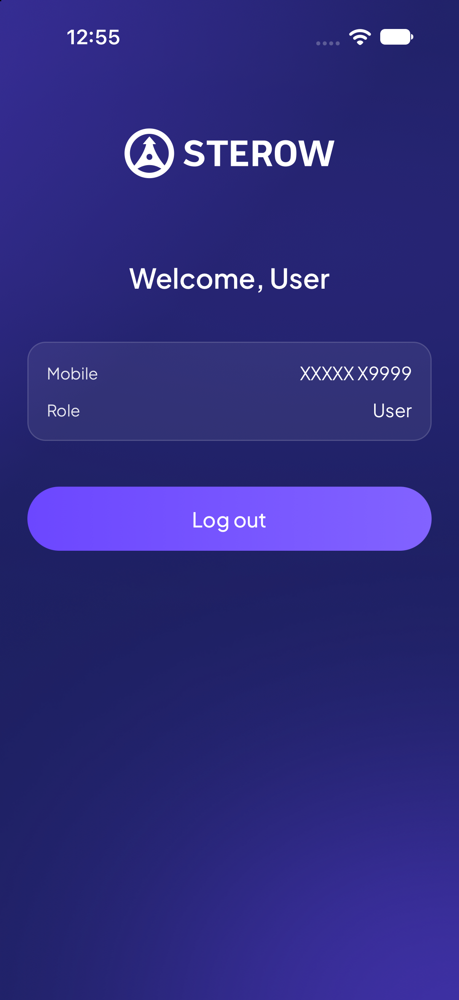
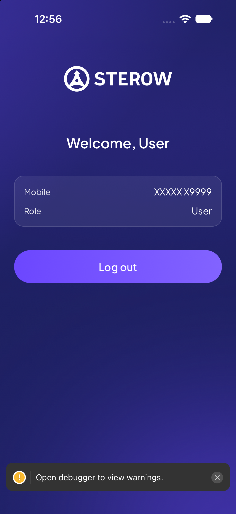
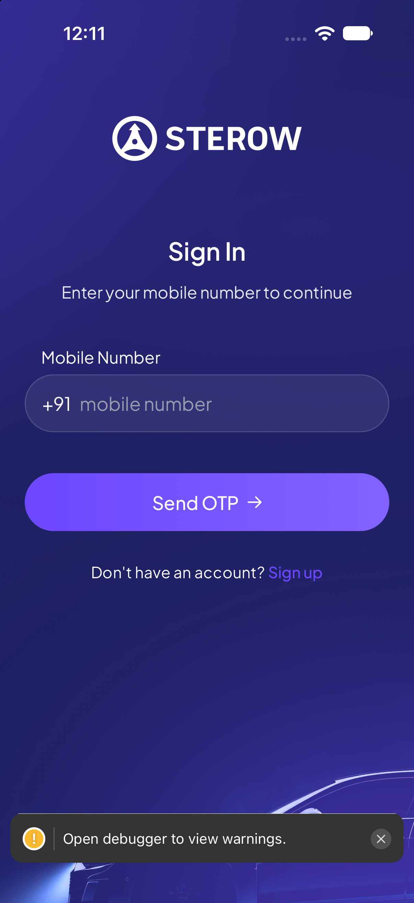
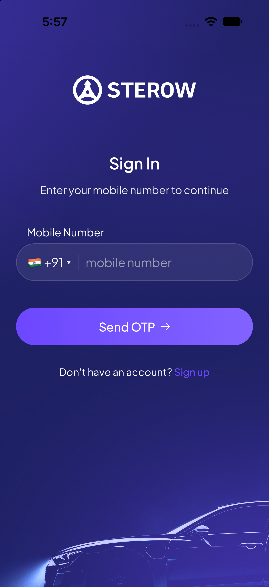

# QA: Auth Phase B (mobile OTP), iOS Simulator

- **Date:** 2026-11-19
- **Build:** Debug, branch `feat/auth-phase-b`, iPhone 18 Pro simulator (iOS 27.2), `.env.development` (demo API)
- **Account:** backend fixed test login `9999999999` / `123456` (no SMS)
- **Tester:** manual taps by the developer; screenshots via `xcrun simctl io booted screenshot`

| # | Scenario | Expected | Result |
|---|---|---|---|
| 1 | Sign Up with the registered test number | Toast "This mobile number is already registered. Please sign in.", switches to Sign In with the number kept | ✅ Pass |
| 2 | Sign In → OTP → wrong code once → correct code | Wrong: shake, red boxes, "Incorrect OTP.", boxes cleared, stays. Correct: auto-submit → Dashboard with name / masked phone / role | ✅ Pass (after fix ①)  |
| 3 | Kill + relaunch | Still signed in (session restored from Keychain) → Dashboard | ✅ Pass  |
| 4 | Log out | Back at Sign In | ✅ Pass |
| 5 | Resend within 30 s blocked; after 30 s works; newest code verifies | No Resend link during "Resend code in 00:xx"; after 30 s Resend → toast + countdown restarts; 123456 verifies with the new requestId | ✅ Pass |
| 6 | Wi-Fi off → Send OTP | Friendly offline message, no crash; back-online toast when restored | ✅ Pass ("No internet connection" shown) |

Launch screen: 

## Issues found and fixed during QA

1. **Wrong OTP on the test login showed the generic error.** The test login returns
   `"Incorrect, expired or disabled test OTP."` (not `"Incorrect OTP."`). Mapped to "Incorrect OTP."
   (inline, shake, red boxes) with a regression test. Commit `0c414ab`.
2. **LogBox warnings for expected 4xx.** The dev logger used `console.warn` for every failed request;
   expected rejections (wrong code, already registered) now log at info level. Commit `0c414ab`.
3. **Metro bundle failure on first launch.** zod 4's ESM build needs
   `@babel/plugin-transform-export-namespace-from` (Jest uses zod's CJS build, so tests didn't catch it).
   Commit `b315b3b`.

## Known, not addressed here

- LogBox at launch: *"StatusBar has no effect because UIViewControllerBasedStatusBarAppearance is NO in
  Info.plist"*. A pre-existing scaffold setting; the status bar renders correctly (light content). Fix in a
  separate change: set `UIViewControllerBasedStatusBarAppearance` to `YES` in `ios/Sterow/Info.plist`.
- *"Sending `onAnimatedValueUpdate` with no listeners registered."*: a known React Native dev-only
  message, not from app code.
- Real SMS delivery to a real number: pending (one final check, per plan).

---

# QA: India + UAE country picker (2026-11-19)

- **Build:** Debug (JS-only change, served by Metro), iPhone 18 Pro simulator (iOS 27.2)
- **UAE wire format:** see `docs/API_PLAN.md` §8. **No OTP was sent to any UAE number.**

| # | Scenario | Expected | Result |
|---|---|---|---|
| 7 | Launch → Sign In (fresh install / no saved country) | `🇮🇳 +91 ▾` + thin divider inside the existing pill; same height and style | ✅ Pass  |
| 8 | Tap the prefix | Bottom sheet: "Select country", 🇮🇳 India +91 ✓, 🇦🇪 United Arab Emirates +971 | ⏳ Needs manual tap → save as `screens/11-country-sheet.png` |
| 9 | Pick UAE, type `050 123 4567` | Prefix `🇦🇪 +971 ▾`, field shows `501234567`; a typed Indian number is cleared on switch; `53…` → "Enter a valid UAE mobile number". **Don't press Send OTP.** | ⏳ Manual → `screens/12-uae-number.png` |
| 10 | Kill + relaunch | UAE is still selected (remembered on the device) | ⏳ Manual |
| 11 | Switch back to India → `9999999999` → Send OTP → `123456` | Verify OTP shows "…ending XXXXX X9999" → Dashboard | ⏳ Manual → `screens/13-verify-india.png` |

Automated coverage for 8–11 (incl. the msw request body per country, VerifyOtp mask + resend for UAE, persistence) is in
`MobileEntryScreen.test.tsx` and `VerifyOtpScreen.test.tsx`.
