# QA: Book a Service flow, UI only (2026-11-24)

- **Build:** Debug, branch `feat/book-service-ui`, iPhone 18 Pro simulator (iOS 27.2), Metro.
- **Designs:** `design/book-service/step1–4-1.svg` (copied from the Figma exports in Downloads), rendered with
  rsvg-convert to `design/book-service/png/` (no SVG needed headless Chrome). **`concern.png` was not in the
  exports**, so the concern panel is built from the brief's text.
- **Assets:** the centre logos were cut from `step3.svg` as 48pt circles with the brand background baked in
  (`src/assets/images/book-service/centre-*.png`, @1x–3x), so no brand colours go into the palette. The icons
  were extracted from the SVG paths as `currentColor` glyphs (`src/assets/icons/book-service/`). Step 1's white
  car is the dashboard's existing `vehicle-car.jpg`.
- **How the screenshots were taken:** dev launch scenarios `-qaScenario book-*` (`src/dev/QaDashboard.tsx`) seed
  the booking store and open a step; `-qaScroll end|<y>` scrolls it (there is no UI automation on this machine).
  Behaviour is covered by Jest: `src/navigation/__tests__/bookService.test.tsx` (26 flow tests),
  `src/store/__tests__/booking.store.test.ts` and `src/utils/__tests__/bookingDates.test.ts`.

| Screen / state | Design | App | Differences |
|---|---|---|---|
| Step 1 Choose Vehicle | `png/step1.png` | 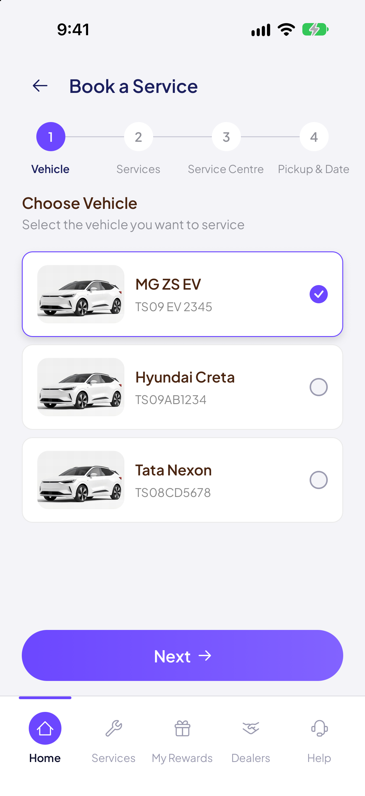 | Real vehicles (the QA seed's MG / Hyundai / Tata) all use the one car photo: vehicles have no photo field, so the design's Volvo photo isn't used. All cards are 94pt tall (the design's selected card is 110pt). |
| Step 1, no vehicles | — | 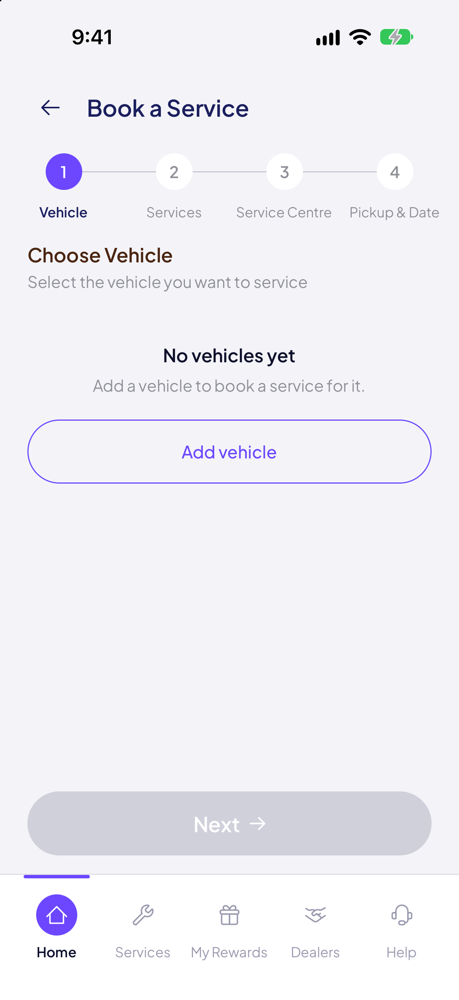 | Empty state + "Add vehicle" (reachable from the drawer; the dashboard tile is disabled without vehicles). |
| Step 2 Raise Your Concern | `png/step2.png` (changed per brief) | 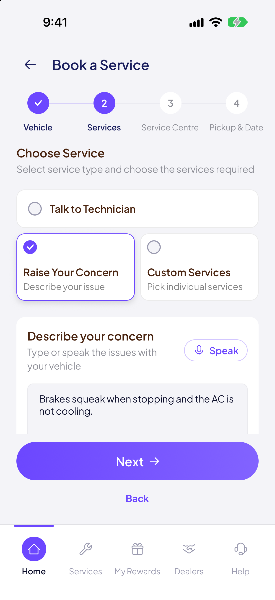 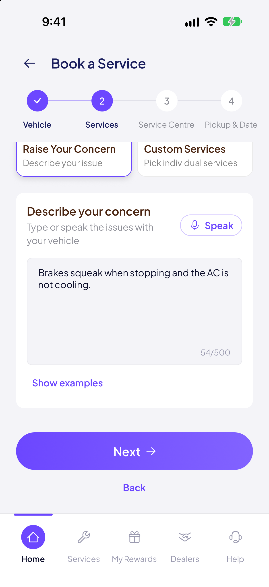 | Added "Talk to Technician" on top. "Service Packages" removed; the cards are "Raise Your Concern" / "Custom Services". The voice card opens from "Speak" (it's always shown in the design). The example prompts are behind "Show examples". |
| Step 2 Talk to Technician on | — | 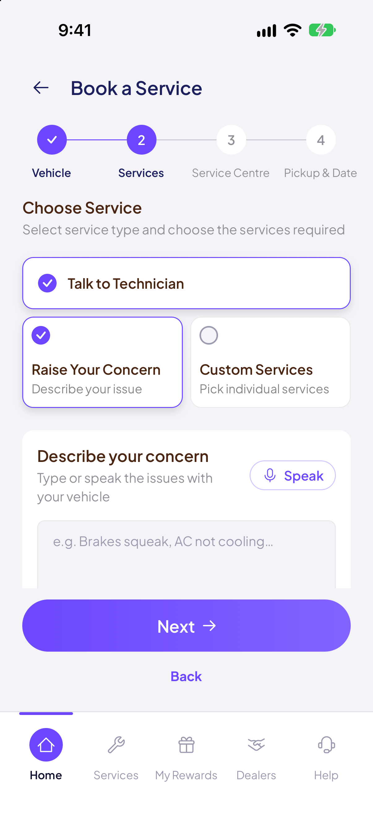 | Concern becomes optional ("Optional while…" note under the box). |
| Step 2 Custom Services | `png/step2.png` | 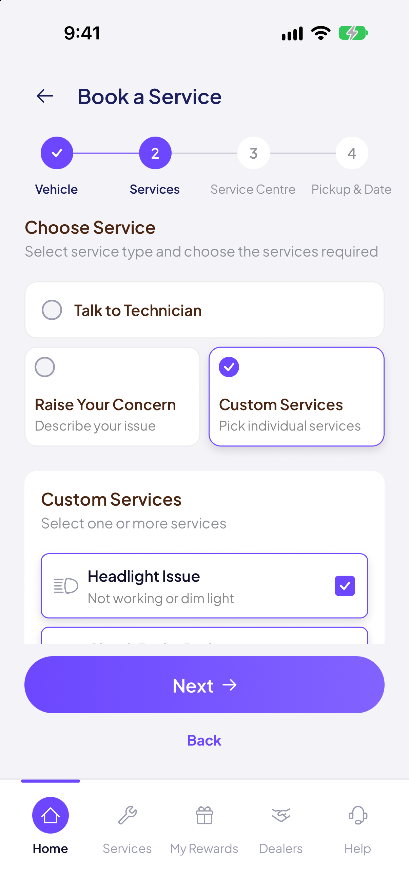 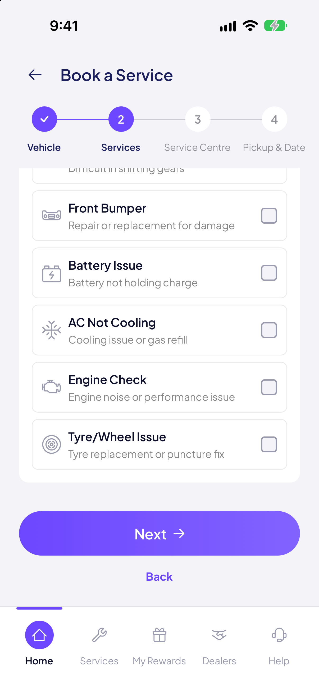 | The subtitle says "Select one or more **services**" (the design says "packages"). Only the chosen mode's panel shows (the design stacks both). |
| Step 3 Choose Service Center | `png/step3.png` | 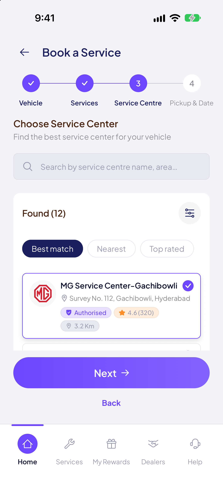 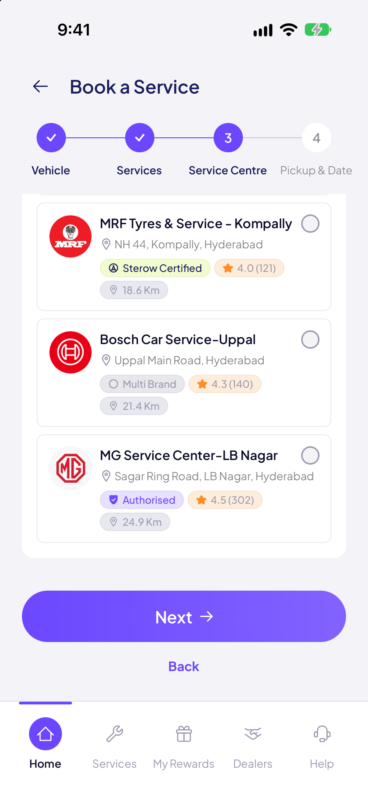 | 12 mock centres, the design's 5 first. The filter sheet has no Figma. Names are 14pt so "MG Service Center-Gachibowli" fits on one line. |
| Step 4, nothing ticked | `png/step4.png` | 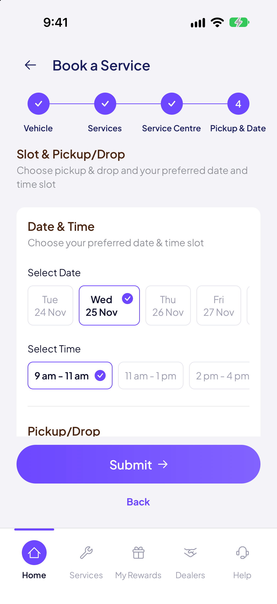 | Dates start today (Figma: sample "Mon 26 Oct"). Slots scroll sideways like the dates (in the design the third chip runs past the card edge). |
| Step 4 Pickup only | `png/step4-1.png` | 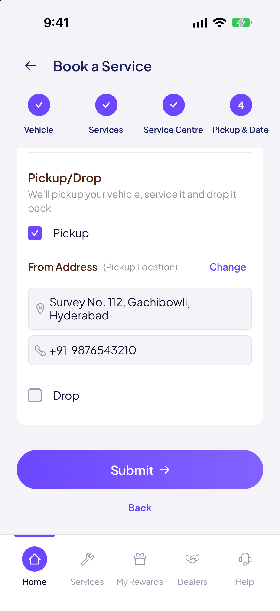 | The address isn't pre-filled until one is chosen ("Select an address"); the phone is the user's own number, unformatted (`9876543210` vs `98765 43210`). |
| Step 4 Pickup + Drop, same as pickup | `png/step4-1.png` | 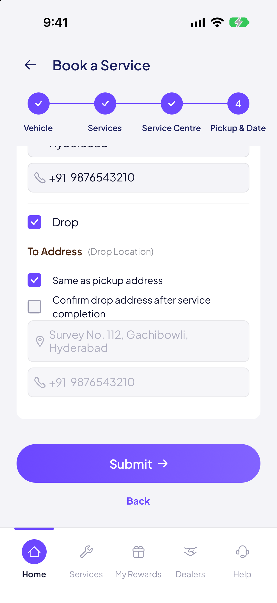 | NEW "Confirm drop address after service completion" checkbox under "Same as pickup address". |
| Step 4 Pickup + Drop, own drop address | — | 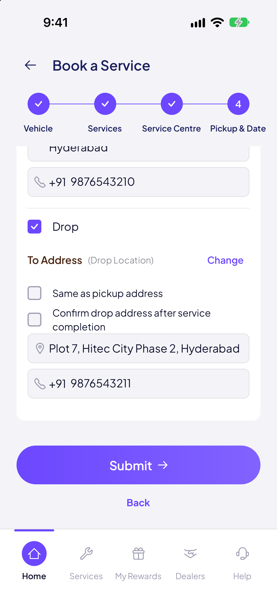 | Editable rows + "Change" on To Address. |
| Step 4 Drop, confirm later | — | 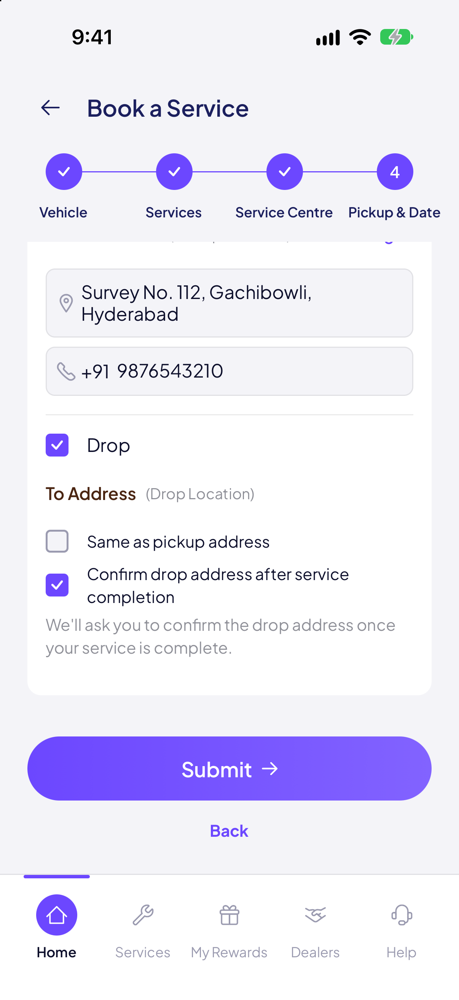 | To Address rows hidden, helper text shown, "Same as pickup" cleared. |
| Step 4 Drop only | — | 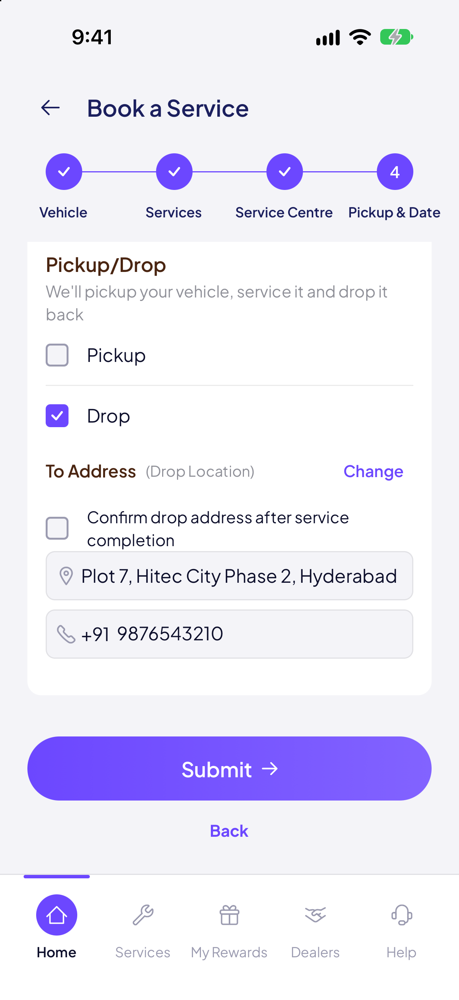 | No "Same as pickup" (nothing to mirror). |
| Congratulations | — (no Figma) | 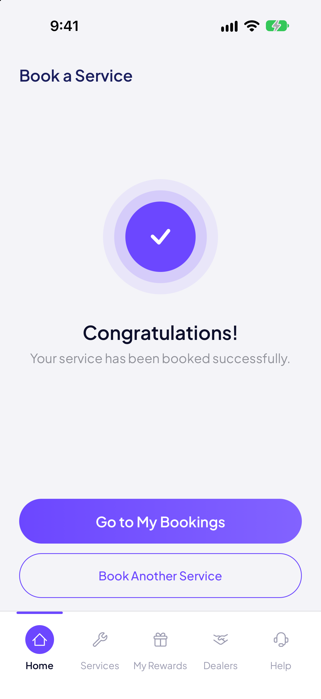 | Exactly two buttons; no back arrow, no summary. Back gesture → Dashboard. |
| My Bookings | — (no Figma) | 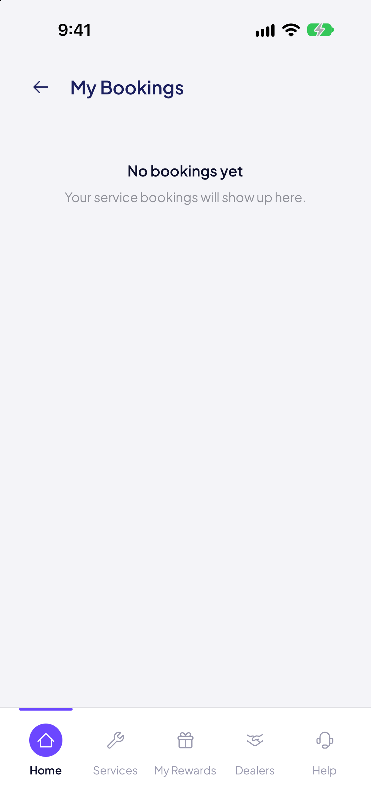 | Placeholder, always "No bookings yet". |

Not captured (sheets are only opened by taps): the filter sheet, the address sheet ("Add new address" + map-pin
placeholder), the voice-language sheet and the voice card's listening state. All are covered by tests.

## Data per element

| Element | Source |
|---|---|
| Vehicles (Step 1) | **Real:** `useMyVehicles` (user_vehicles) |
| Phone default (Step 4) | **Real:** the signed-in user's phone |
| Services list, centres, time slots, saved addresses, voice languages, concern examples | **Mock:** `src/constants/bookServiceMock.ts` via `src/services/bookingService.ts` |
| Submit | **Mock:** `bookingService.createBooking` stores nothing; the dashboard's Book Service count stays the real `service_bookings` count (tested) |
| Voice input | **Stub:** `useVoiceInput` (no recording) |

## Design questions

1. **concern.png is missing** from the exports. Please share it; the panel is built from the brief's text
   ("Describe your concern", the Speak button, the textarea, the counter).
2. **Default service type:** the app starts on "Raise Your Concern" (the first card). Should it start with
   nothing selected, or on Custom Services as step2.svg shows?
3. **Talk to Technician:** shown as a full-width radio card above the two options. Does concern.png place it
   differently, or give it a subtitle?
4. **Voice card:** shown only after tapping "Speak", where step2.svg always shows it. Which is intended?
5. **Custom Services subtitle:** "Select one or more packages" in the design; the app says "services" because
   packages are gone. OK?
6. **Selected vehicle card** is 110pt tall in step1.svg vs 94pt for the others. The app uses 94pt for all; was
   that intentional?
7. **Vehicle photos:** the design shows per-model photos (white MG, black Volvo), but vehicles have no photo
   field yet, so every card uses the generic white car.
8. **Time slots:** in step4.svg the three chips overflow the card. The app scrolls them sideways like the
   dates; or should they wrap?
9. **Phone format:** the design shows "+91 98765 43210"; the app shows the editable 10 digits. Should it
   format as you type?
10. **Pickup address:** not pre-filled (saved addresses are mock data and must not pose as the user's).
    Once the API exists, should the user's default address be pre-filled as in step4-1.svg?
11. **Filter sheet, address sheet, Congratulations, My Bookings** have no Figma; please design them.
12. **Stepper on Congratulations:** hidden there (no step is current). OK?
