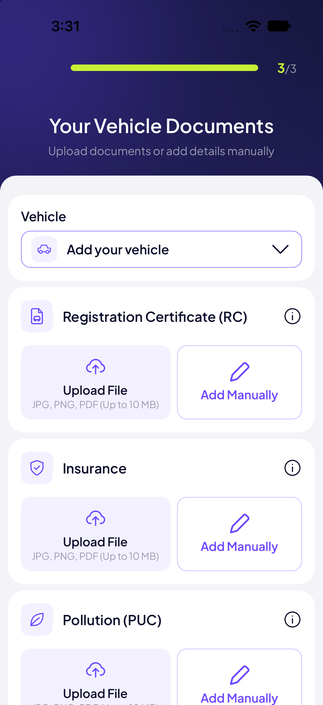
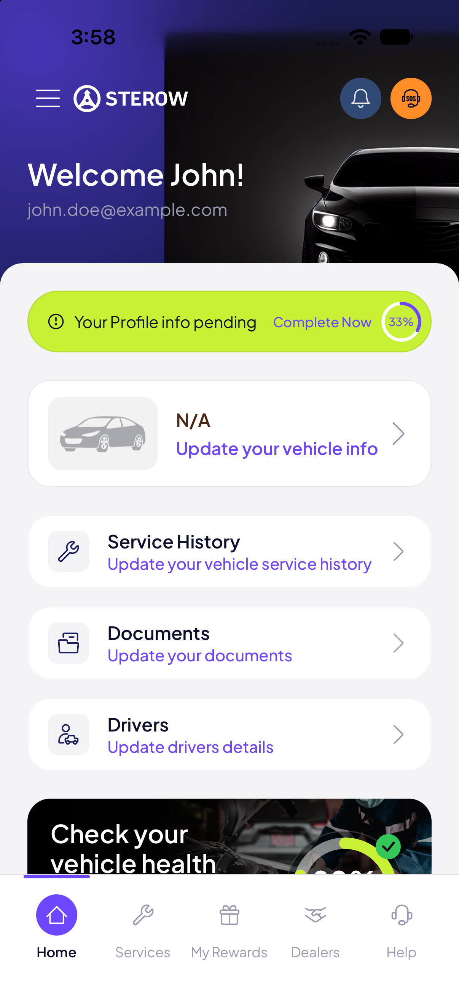
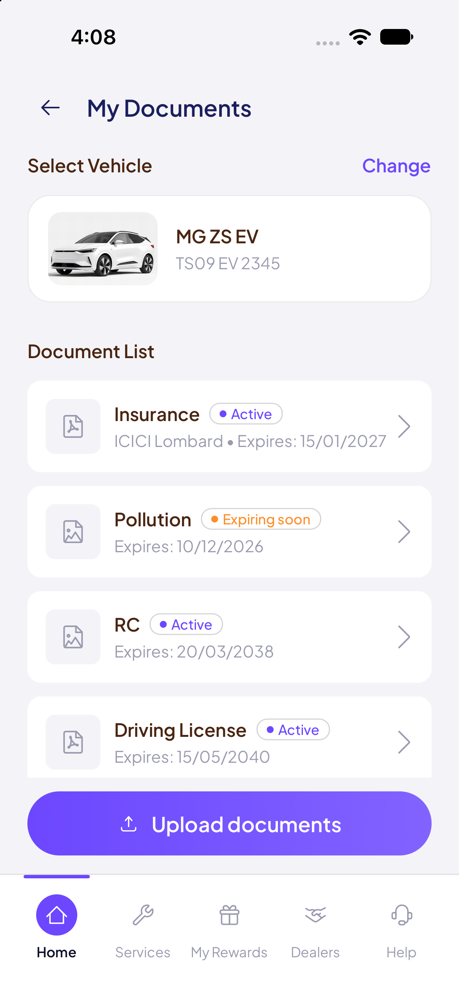
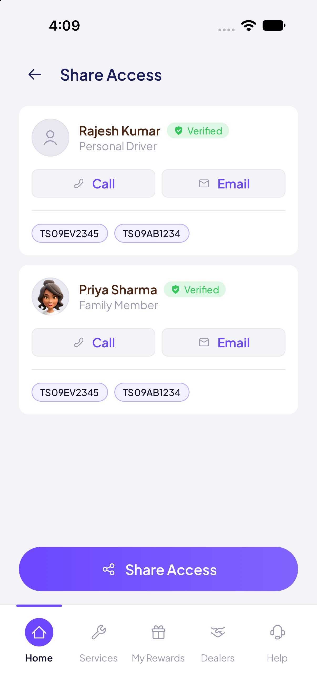
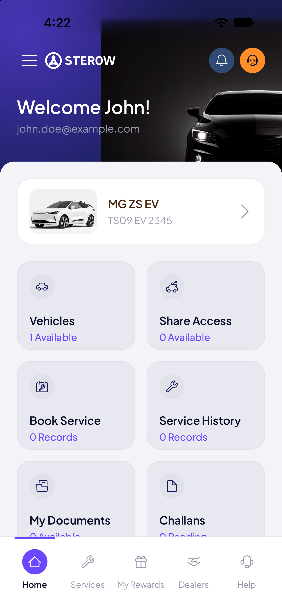
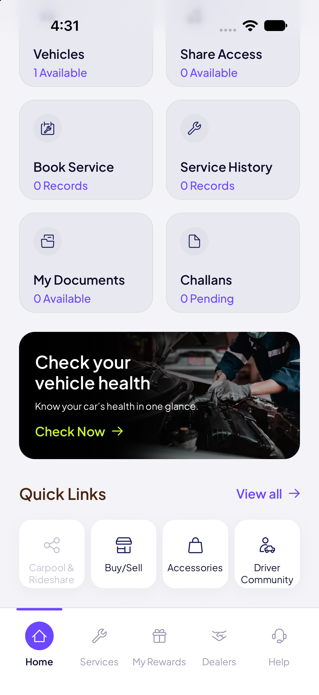
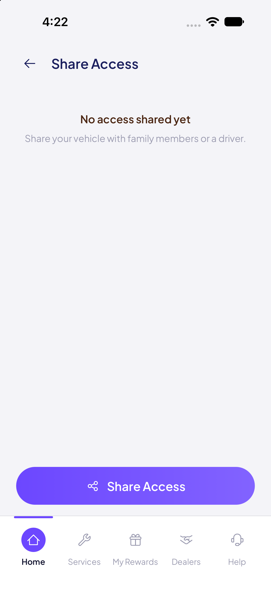
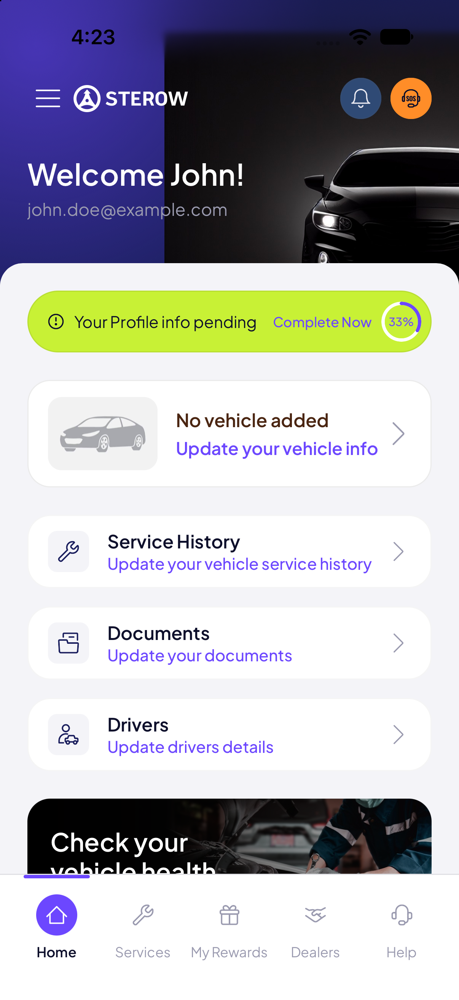
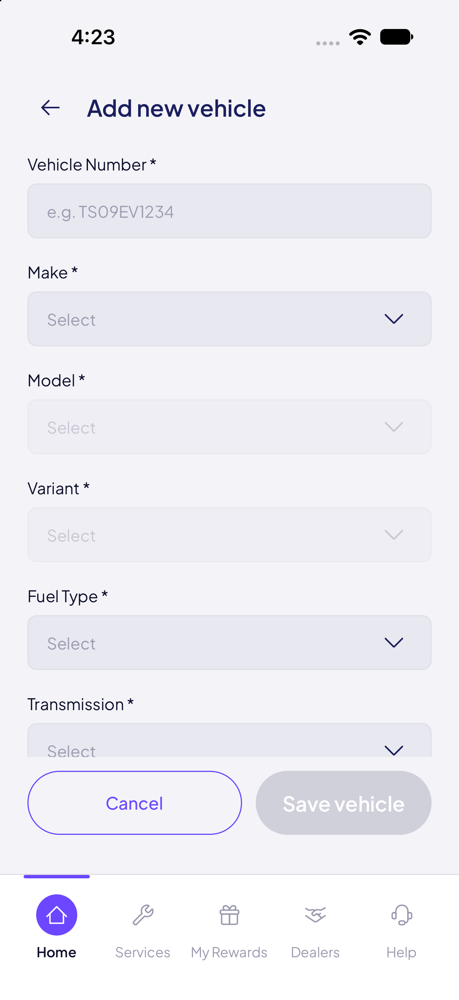
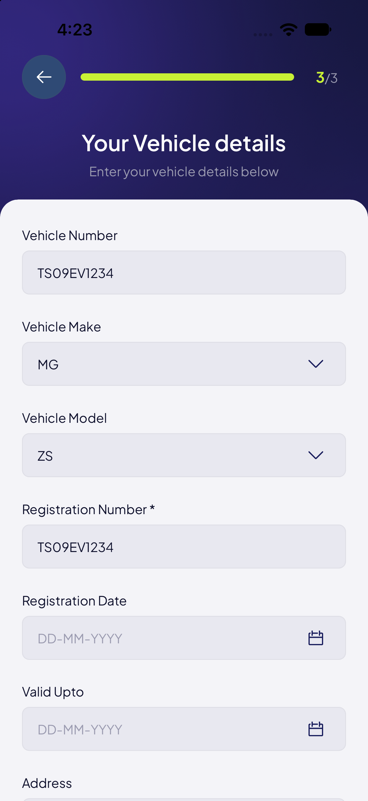

# QA: Dashboard, drawer, light screens and the new 3/3 (2026-11-23)

- **Build:** Debug, branch `feat/dashboard-ui`, iPhone 18 Pro simulator (iOS 27.2), Metro.
- **Designs:** `design/dashboard/` (copied from the Figma exports in Downloads; `drivers.svg` was the Share
  Access screen and is stored as `share-access.svg`). Renders in `design/dashboard/png/` (rsvg-convert; the
  three SVGs with >10 MB embedded images via headless Chrome).
- **How the screenshots were taken:** the dev launch states (`-qaScenario …`, `src/dev/QaOnboarding.tsx`,
  `src/dev/QaDashboard.tsx`) open each screen with seeded data; no sign-in or taps are possible on this
  machine (no UI automation). Behaviour is covered by Jest + msw (46 suites, 399 tests).
- **Not visible in the screenshots:** content below the fold (the simulator can't be scrolled from here):
  the dashboard's health banner / Quick Links, 3/3's PUC / FASTag cards, the drawer's last two rows.

| Screen | Design | App | Differences |
|---|---|---|---|
| 3/3 Your Vehicle Documents (empty) | `vehicle-documents-step.jpeg` |  | "3/3" (design says 3/4, see questions); no vehicle yet → "Add your vehicle" (design shows a selected vehicle); icon tiles are violet-tinted (the JPEG reads slightly greyer); selector 44pt tall (≈ 41 in the JPEG, kept for the touch target); FASTag card added last (not in the design). |
| 3/3 with documents | — |  | States not in the design: "✓ Added", the file preview + remove, "Add details" + the hint for an Insurance file without its details. |
| Dashboard (complete) | `png/dashboard.png` |  | Header glow approximated with a radial gradient (Figma: blur 177); the status bar is dark only in the QA launch (the app sets light content on the dashboard). |
| Dashboard incomplete (variant 1: has a vehicle) | `png/dashboard-incomplete.png` |  | Shows the user's vehicle in the carousel (the design shows "N/A" with the grid: we show N/A only without a vehicle, which is variant 2); % is computed (67%) vs the design's sample 50%. |
| Dashboard incomplete (variant 2: no vehicle) | `png/dashboard-incomplete-2.png` |  | Matches; the designs show the Home tab unselected, the app keeps Home selected. |
| Side drawer | `png/side-drawer.png` |  | Matches; on the 874pt-tall phone the last rows (Help, Change Language) scroll (the Figma frame is 1039pt). |
| My Profile | `my-profile.png` |  | DOB / Emergency Contact show "Add" (no backend field yet); completion from the onboarding parts; Home tab selected (the design shows none). |
| My Documents | `png/my-documents.png` |  | Status pills also show "Expiring soon" (orange) / "Expired" (red); "Change" only when there's more than one vehicle. |
| Share Access | `png/share-access.png` |  | Seeded dev data (the design's two people); the app reads `vehicle_shares`. No Email button (no e-mail column). |
| Dashboard, no data (2026-11-24) | — |  | A vehicle, no documents / shares / bookings: every tile 0; Challans "0 Pending" in violet (below the fold here). |
| Dashboard, no data, scrolled to the end (2026-11-24) | — |  | Last tile row (My Documents / Challans "0 Pending"), the health banner (no score) and Quick Links all sit above the tab bar: the tab bar is laid out below the scroll view, not over it (taken with a temporary scrollToEnd, not committed). |
| Share Access, no shares (2026-11-24) | — |  | Empty state "No access shared yet" + Share Access. |
| Dashboard, no vehicle (2026-11-24) | `png/dashboard-incomplete-2.png` |  | "No vehicle added" instead of the design's "N/A". |
| Add new vehicle (2026-11-24) | — |  | Seeded master data (MG ZS Essence). |
| RC → Add Manually (2026-11-24) | — |  | "Your Vehicle details", seeded as in User Onboarding - 2b. |
| My Vehicles | — (no Figma) |  | Placeholder list using the carousel card + "Add vehicle". |

## Data per element

| Element | Source |
|---|---|
| Name, email, avatar | `user_details` (profile service) |
| Vehicles (carousel, Vehicles tile, selector) | `user_vehicles` active, names embedded |
| My Documents tile, list | `vdocs_*` rows + `user_driving_licenses` |
| Share Access tile, screen | `vehicle_shares` (owner_id = uid, is_active), grouped per member; tile = number of people |
| Book Service tile | `service_bookings` count, customer_id = uid, open statuses |
| Service History tile | `service_bookings` count, customer_id = uid, service_completed … delivered |
| Challans | no API: "0 Pending" (neutral) |
| Health score | no API: ring hidden (was a static 80%) |
| Quick Links, bell, SOS | Coming soon |
| Profile completion % | `getProfileCompletion` (src/utils/profileCompletion.ts): name, email, photo, mobile, licence number + file, a vehicle with a document (6 × equal weight) |

## Design questions

1. **3/4 vs 3/3:** the vehicle-documents design shows "3/4"; the agreed flow has 3 steps, so the app shows 3/3.
2. **FASTag card:** not in the design; added last in the same card style (agreed flow). Please add it to Figma.
3. **Incomplete variant:** we show variant 2 (task list) when the user has **no vehicle**, variant 1 (grid)
   otherwise. Variant 1's "N/A" card only makes sense without a vehicle; confirm.
4. **My Vehicles:** no Figma yet; placeholder list.
5. **Tab state on drawer screens:** the designs show no tab selected on My Profile / My Documents / Share
   Access; in the app they live in the Home tab, so Home stays selected.
6. **Header bell + SOS:** in the design but not in the brief; they open Coming soon.
7. **Dog photo:** the dashboard SVG embeds an unrelated dog photo under the carousel car (hidden by the car
   image); not used in the app.

## TODO

- [ ] **Verify `service_bookings.customer_id` with a real booking** (with the Book Service API work).
  The dashboard's Book Service / Service History counts filter `customer_id = <uid>`. Checked 2026-11-24
  with `npx tsx scripts/probe-bookings-shares.ts` (read-only, fixed test login): the column exists
  (an unknown column returns 42703), but the test account has **no booking**, so it's unproven that
  `customer_id` holds the booking customer's user id (the web's bookings code reads it that way). Once a
  booking exists for a test account, re-run the probe: it prints `customer_id === uid ?` for the first
  visible booking. If it's false, fix the filter in `src/api/services/dashboard.service.ts` and its test.
