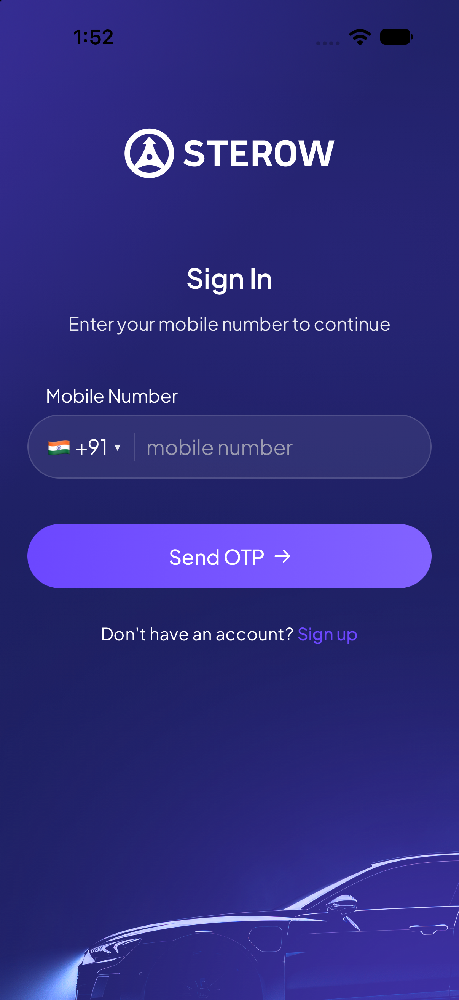
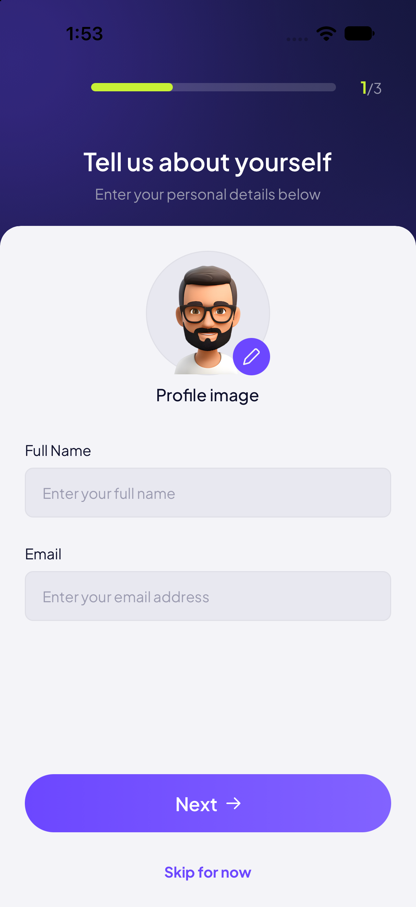
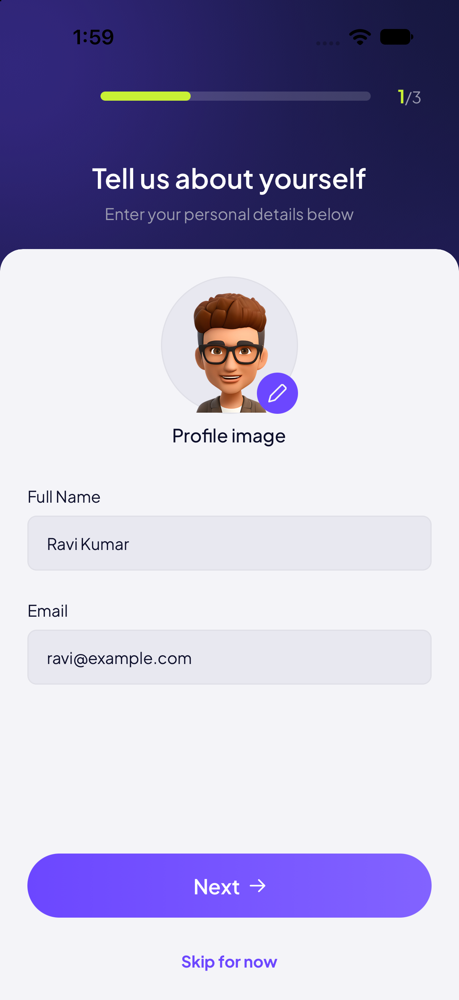
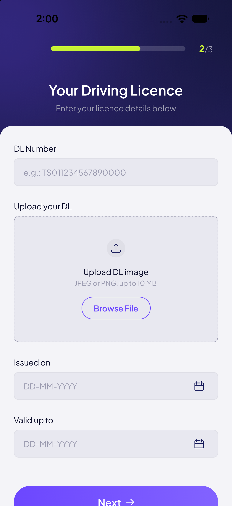
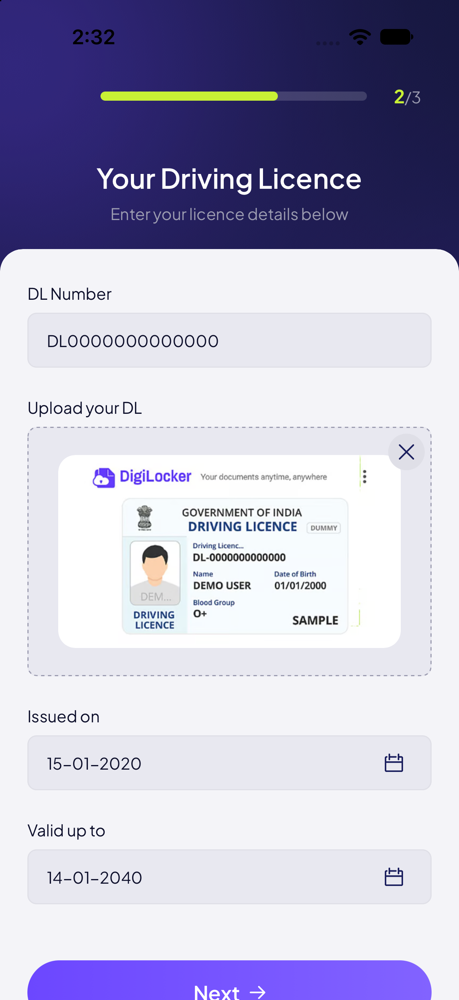
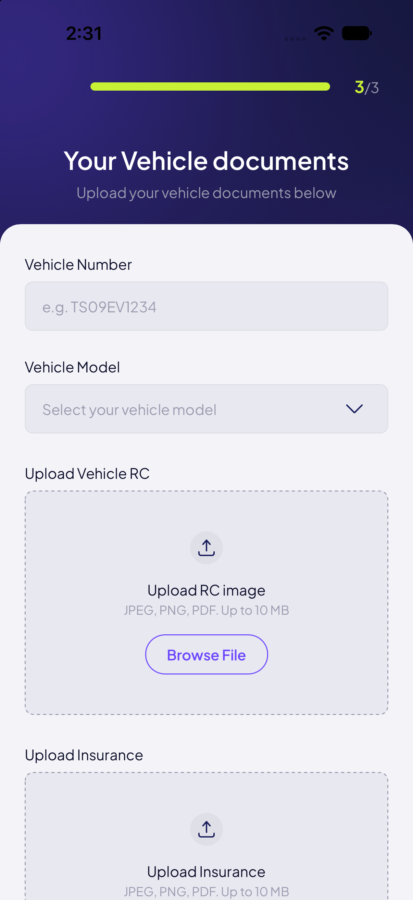
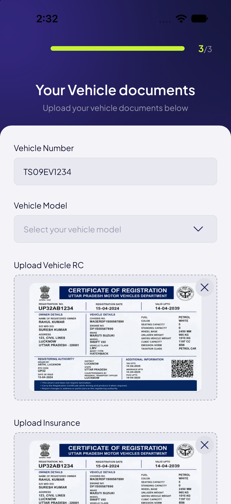

# QA: Phase 1 onboarding with the API (3 steps), 2026-11-23

- **Build:** Debug, branch `feat/phase1-onboarding-api`, iPhone 18 Pro simulator (iOS 27.2), Metro, `.env.development` (demo backend)
- **Account:** fixed test login `9999999999` / `123456` (writes only with this account)
- **Flow:** Sign-in → 1/3 My Profile → 2/3 Driving Licence → 3/3 Vehicle documents → Dashboard

## How this was tested (and what wasn't)

| Layer | How | Result |
|---|---|---|
| Every screen on the simulator | Real app on the simulator; the dev launch states (`-qaScenario`, `src/dev/QaOnboarding.tsx`) open each step seeded, screenshots via `xcrun simctl io booted screenshot` | ✅ screenshots below |
| Every backend write the app makes | Live scripts that send exactly the app's requests (shapes pinned by the msw tests) with the test account, reading each write back | ✅ see "Live backend" |
| Navigation, routing, save sequences, errors, retries, double submit | Jest + msw through the real app tree (sign-in → steps → Dashboard → relaunch) | ✅ 41 suites / 376 tests |
| **Tapping through the signed-in flow on the simulator** | Needs taps / typing (OTP, pickers). This machine has no UI-automation tool (no idb / Maestro / Detox; the simulator runs headless, no Simulator.app) | ⏳ **manual run needed**: checklist below. |

## Screens (simulator)

| # | Screen | Check | Result |
|---|---|---|---|
| 0 | Signed-out launch | Sign In | ✅  |
| 1 | 1/3 My Profile (empty) | "1/3", progress ⅓, Profile photo (preset pre-selected), **Full Name, Email: no DOB**, no back arrow as start route | ✅  |
| 2 | 1/3 filled | name, email, preset avatar | ✅  |
| 3 | 2/3 Driving Licence (empty) | "2/3", DL Number, upload box (no "Or": OCR unavailable), Issued on, Valid up to | ✅  |
| 4 | 2/3 filled | number, DUMMY sample licence photo, 15-01-2020 / 14-01-2040 | ✅  |
| 5 | 3/3 (empty) | "3/3", **Vehicle Number + Vehicle Model** on top, then RC, Insurance, Pollution, FASTag cards | ✅  |
| 6 | 3/3 filled | vehicle number, RC + Insurance attached (Insurance's Policy Number + Insurer appear under its card, below the fold) | ✅  |

The model list is empty in the seeded screens: they run without a signed-in user, and the master data
is only readable when signed in. The signed-in list ("Make Model – Variant", active variants) is covered
by `documentsStep.api.test.tsx` and confirmed live (the live run picked "MG ZS EV Essence").

## Live backend (test account, 2026-11-23)

| Step | Script | Result |
|---|---|---|
| Avatar upload → `user_details.avatar_url` → signed URL | `scripts/live-profile-dl.ts avatar` | ✅ |
| DL upload → upsert (number, path, Issued on, Valid up to) → signed URL | `scripts/live-profile-dl.ts dl` | ✅ first run; ❌ after a DL delete: **backend bug O6** (below) |
| `user_details.email` can be updated | no-op PATCH (same value) | ✅ 1 row → Email is editable on 1/3 |
| Real required columns (vehicle, insurance) | `scripts/probe-required-fields.ts` (approved) | ✅ API_PLAN §9.4 |
| 3/3: minimal vehicle + RC + Insurance + Pollution + FASTag (files in `vehicle-docs/<uid>/<table>/<uuid>.png`), read back, signed URLs | `scripts/live-documents.ts TS00QA0001` | ✅ 18/18 checks; routing count = 1 active vehicle (relaunch → Dashboard) |
| Reset | `scripts/reset-test-account.ts --yes` | ✅ 4 documents + files removed, vehicle deactivated; refuses any other account (✅ tried with 9876543210) |

## Manual tap-through (⏳ needs a person at the simulator)

Before: `npx tsx scripts/reset-test-account.ts --yes` and `xcrun simctl keychain booted reset`.
Use a **new vehicle number** each run (numbers stay taken: vehicles can only be deactivated).

| # | Steps | Expected |
|---|---|---|
| M1 | Launch → Sign In → 9999999999 → 123456 | Splash, then **1/3** (no DL) with no back arrow; Full Name prefilled from user_details |
| M2 | Change name / email / avatar → Next | "Photo updated" (or "Profile saved") → 2/3 |
| M3 | 2/3: number + photo + dates → Next | **Currently fails for the test account** with "Your earlier licence was removed and can't be replaced yet. Please contact support." (O6). After the backend restores the row: "Driving licence saved" → 3/3 |
| M4 | 2/3 Skip (while O6 is open) | → 3/3 |
| M5 | 3/3: vehicle number + model; attach RC, Insurance (+ policy no. + insurer), PUC (+ certificate no.), FASTag (+ id) → Next | Spinner, "Vehicle and documents saved" → Dashboard, no Back to onboarding; demo.sterow.in → My Vehicles / My Documents shows them |
| M6 | Kill + relaunch | Straight to the Dashboard (active vehicle) |
| M7 | Reset → fresh login → Skip, Skip, Skip | 1/3 → 2/3 → 3/3 → Dashboard; relaunch → Dashboard |

## Issues found

1. **O6 (backend): a deleted DL can never be re-saved.** Delete = soft delete; the hidden row keeps the
   unique `user_id`; upsert → `42501 … policy "Hide deleted rows"`, insert → `23505`. Hit while testing
   the reset script; the test account is in this state now. The app shows a specific message; the reset
   script only deletes the DL with `--include-dl`. **Needs backend: restore / hard-delete the test
   account's DL row, and make upsert revive soft-deleted rows.**
2. **O7 (backend):** vehicles can't be deleted ("Use ownership transfer instead"). Two deactivated test
   vehicles stay on the test account (`TS00ZZ0001` probe, `TS00QA0001` QA).
3. **O8 (data):** `variant_id` is NOT NULL but only 3 variants exist, so most real cars can't be added.
4. The simulator stopped responding to Metro under load once (8 GB machine); retaking the screenshot
   one at a time fixed it. Not an app issue.
5. An orphan DL file is left in `driving-licenses/<uid>/` from the O6 failure (the upload succeeded,
   the upsert didn't). `--include-dl` removes it.
